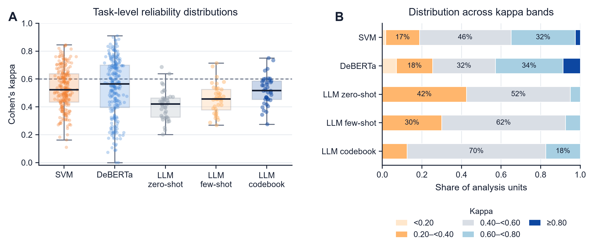

# A decision support framework for model selection in automated engineering text coding

This repository accompanies the manuscript of the same title.

The decision support framework connects task characterization, coding reliability prediction and improvement priorities to guide model selection and annotation investment before full model development. It characterizes tasks using five measurable attributes: **label number, class imbalance, training sample size, label semantic similarity, and human coding disagreement rate**. Its effectiveness is empirically validated through construction contract function coding using 17,778 deduplicated contract sentences.

The released materials include the study code, task-level results, statistical analyses, fitted performance predictors and figure source data. The repository is organized so that readers can inspect the evidence, verify the reported results and rerun the analyses from the released records.

## Start here

| Purpose | Entry point |
|---|---|
| Understand the study and find the files behind each result | [Method-to-file map](docs/METHOD_FILE_MAP.md) |
| Inspect the 600 model–task records used for performance prediction | [Prediction dataset](results/step6_performance_prediction/diagnostics/prediction_unified_analysis_data.csv) |
| Understand the five task characteristics and analysis units | [Data dictionary](docs/DATA_DICTIONARY.md) |
| Verify record counts and the two principal prediction RMSEs | `python reproduce.py --steps verify` |
| Reproduce statistical analyses | [Analysis instructions](#reproduce-the-analyses) |
| Inspect or redraw the six manuscript figures | [Figure index](figures/README.md) |
| Apply a saved task-performance predictor | [Prediction example](#predict-performance-for-a-task-profile) |
| Understand data availability and the limits of reproduction | [Data availability](#data-availability) |

## Study design

| Component | Analysis units |
|---|---:|
| Controlled supervised-learning tasks | 240 |
| SVM and DeBERTa-v3-base evaluations | 480 |
| LLM label combinations | 40 |
| LLM prompting strategies | 3 |
| LLM evaluations, with three calls per combination–strategy cell | 360 |
| LLM combination–strategy means | 120 |
| Combined model–task records for performance prediction | 600 |
| Label combinations used for the matched Common24 comparison | 24 |

The experiments compare SVM, DeBERTa-v3-base and DeepSeek V4-Flash. The three LLM prompting strategies are zero-shot, few-shot and codebook-guided coding. The prediction dataset combines 480 supervised-model records with 120 LLM means; the repeated LLM calls are not treated as separate prediction tasks.

## Main findings

- Supervised-model reliability decreases with more labels, greater class imbalance and higher label semantic similarity, but improves with training sample size. Label number and training sample size change the relative performance of SVM and DeBERTa-v3-base.
- For DeepSeek V4-Flash, codebook-guided prompting achieves an adjusted Kappa of 0.518, compared with 0.455 for few-shot and 0.413 for zero-shot prompting. Its advantage over few-shot prompting diminishes as human coding disagreement rate and label semantic similarity increase.
- Predictors trained on 600 model–task records estimate candidate configurations' coding reliability from task characteristics and model configuration. Gradient boosting trees achieve a Kappa prediction RMSE of 0.084 in record-level cross-validation; ridge regression achieves 0.110 when entire label combinations are held out. These values measure errors in predicting coding reliability, rather than the coding reliability scores themselves.

The estimated relationships inform priorities for data expansion, class balancing, task decomposition, codebook revision and human review.

## Repository structure

```text
code/                         Model training, evaluation and statistical analysis
  figures/                    Final figure-generation script
preprocessing/                Corpus processing and controlled-task construction
  processed/                  Aggregate task-design metadata
data/task_records/           Recorded task-level performance
manifests/                    Task mappings, label combinations and codebook
metadata/                     Label semantic similarity matrix and ranked pairs
materials/                    Prompt templates with text placeholders
results/                      Archived analyses, predictions and fitted predictors
figures/                      Figures 1–6 and their plotted source data
docs/                         Variable definitions, method mapping and validation notes
reproduce.py                  Verification and analysis entry point
requirements-analysis.txt     Statistical analysis and figure dependencies
requirements-training.txt     Original text-model training dependency specification
requirements-embeddings.txt   Optional label-embedding dependencies
SHA256SUMS.csv                 File integrity checks
SOURCE_MANIFEST.csv           Source-to-release file mapping
```

Historical code paths, filenames and machine-readable fields containing `complexity` are retained for compatibility with the original analyses. In the current manuscript, the five indicators are collectively described as **task characteristics**. [DATA_DICTIONARY.md](docs/DATA_DICTIONARY.md) maps the retained fields to this terminology.

## Verify the released results

Clone the repository and run the lightweight verification:

```sh
git clone https://github.com/Tianchenxcl/engineering-text-coding-task-complexity.git
cd engineering-text-coding-task-complexity
python reproduce.py --steps verify
```

This command uses only the Python standard library. It checks file integrity, Python syntax, task counts, unique prediction records and the grouping of held-out label combinations. It also recalculates the following root mean square errors (RMSEs) for predicting coding reliability, measured by Kappa, from saved out-of-fold predictions:

| Validation design | Predictor | RMSE |
|---|---|---:|
| Record-level stratified validation | Gradient boosting trees | 0.084131 |
| Label-combination-held-out validation | Ridge regression | 0.110414 |

These validation designs address different prediction settings. Record-stratified validation measures interpolation within the observed task space, where label combinations appear in both training and test folds. Grouped validation holds out entire label combinations and provides the more conservative assessment for unseen combinations.

## Reproduce the analyses

Use Python 3.11 or later in a dedicated environment:

```sh
python -m venv .venv
```

Activate it with `.venv\Scripts\Activate.ps1` in Windows PowerShell, or `source .venv/bin/activate` on macOS/Linux, then install the analysis dependencies:

```sh
python -m pip install -r requirements-analysis.txt
```

Run individual stages as needed:

| Stage | Command | Output |
|---|---|---|
| Data preparation and quality checks | `python reproduce.py --steps 1` | Analysis-ready task records |
| Descriptive reliability analysis | `python reproduce.py --steps 2` | Reliability summaries and bootstrap intervals |
| Effects of task characteristics on supervised models | `python reproduce.py --steps 3` | Mixed-effects models and adjusted predictions |
| LLM prompting and task characteristics | `python reproduce.py --steps 4` | Prompt comparisons and interactions |
| Matched Common24 comparison | `python reproduce.py --steps 5` | Comparisons on matched label combinations |
| Grouped performance prediction | `python reproduce.py --steps 6-grouped` | Validation on unseen label combinations |
| Record-stratified prediction | `python reproduce.py --steps 6-record` | Validation within the observed task space |
| Diagnostic scenarios | `python reproduce.py --steps 7` | Task diagnoses and predicted improvement scenarios |
| Robustness checks | `python reproduce.py --steps 8` | Sensitivity and stability analyses |
| Fractional-logit sensitivity | `python reproduce.py --steps fractional` | Alternative response-distribution analysis |
| Final manuscript figures | `python reproduce.py --steps figures` | Six figures in PNG, PDF, SVG and TIFF |

Several stages can be run in order, for example:

```sh
python reproduce.py --steps 1 2 3 4 5
python reproduce.py --steps 6-grouped 6-record 7 8
```

To run the complete statistical workflow:

```sh
python reproduce.py --steps all
```

New outputs are written to `reproduced/`; the archived `results/` remain unchanged. When running an isolated stage, the runner first copies archived upstream results to `reproduced/statistical_analysis/`. Later selected stages use that working copy. The figure and fractional-logit commands use the archived results.

The nested prediction analyses can take considerably longer than the lightweight verification. These commands operate on task-level records: they do not retrain SVM or DeBERTa and do not make LLM API calls. Step 1 skips sentence-level test-set alignment because the contract texts are not included.

### Prediction validation settings

- **Record-stratified:** 10 outer folds stratified by model variant, with five inner folds for hyperparameter selection. Final deployment tuning uses 10 folds.
- **Grouped:** eight outer folds and five inner folds, grouped by label combination.

Some archived filenames retain the historical term `sensitivity`. The saved fold assignments and split definitions determine the interpretation of each result.

## Predict performance for a task profile

An example input file contains five hypothetical candidate configurations. To apply the grouped-validation predictor:

```sh
python code/predict_new_task_performance.py --input results/step6_performance_prediction/predictions/prediction_input_template.csv --models-dir results/step6_performance_prediction/models --output reproduced/new_task_predictions.csv
```

The saved recommendation selects ridge regression. The output estimates candidate configurations' coding reliability, measured by Kappa, Macro-F1 and MCC, from task characteristics and model configuration. These task-performance predictors support model selection before full model development; sentence coding is performed by the candidate models. Predictions should be interpreted within the observed ranges of task characteristics; application to a new engineering-text domain requires validation and calibration.

## Figures

All six figures are available as individual PNG, PDF and SVG files in [figures/](figures/), together with their plotted source data. The [figure index](figures/README.md) links each figure to the corresponding analysis. TIFF versions can also be generated with `python reproduce.py --steps figures`.



## Data availability

We share task-level performance records, aggregate task-design metadata, the label codebook, the semantic similarity matrix, prompt structure, statistical outputs and figure source data. **Original contract sentences, sentence-level annotations, real few-shot demonstrations, text-model checkpoints and API response logs are not included in this public release.**

The released records support statistical reanalysis and figure reproduction. Reconstructing sentence-level test scores or repeating the original text-model experiments requires the private corpus and annotations. We retain the corresponding preparation and training code for methodological transparency; see [PRIVATE_DATA_WORKFLOW.md](docs/PRIVATE_DATA_WORKFLOW.md).

The label-similarity script in `preprocessing/compute_label_similarity_recovered.py` implements the notebook workflow recovered from our project records. It encodes label names and definitions with `sentence-transformers/all-mpnet-base-v2`. The original model revision and full embedding environment were not retained, and this restored script has not been rerun against the archived matrix. The archived matrix is the input used for downstream reproduction.

## Validation and software notes

We checked the release against the archived results: task counts and principal RMSEs agree; 46 regenerated statistical tables agree with their archived counterparts; and all six regenerated PNG figures are pixel-identical to the final figures. The saved ridge predictor also runs on the supplied example profiles. Detailed checks and limits are recorded in [RELEASE_PROVENANCE.md](docs/RELEASE_PROVENANCE.md).

The analysis dependencies reflect the local analysis and figure environments. The original cloud training specification contains version ranges rather than a complete environment lockfile. A fresh dependency installation, original text-model retraining and full nested-CV refitting were not part of the release checks.

`code/train_additional_traditional_ml.py` is an optional exploratory script. Its additional algorithms are not included in the main 600-record analysis.

## Citation and correspondence

The manuscript title is given above. Bibliographic details will be added when available. For questions about the code or released results, please open an issue in this repository.
